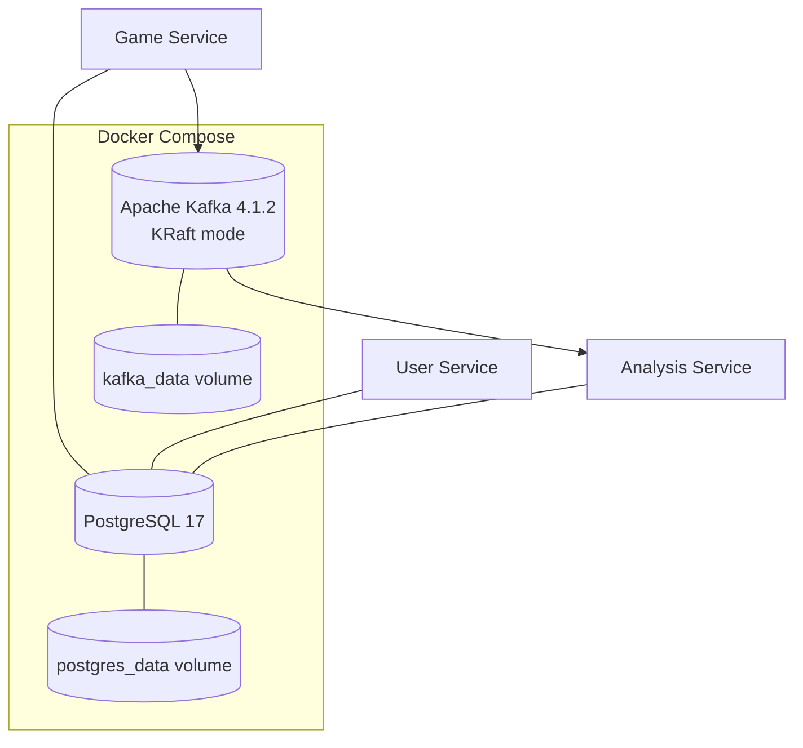

<div align="center">

# ⚙️ ChessTracker Infrastructure

### PostgreSQL + Kafka for a multi-service chess platform.

[](https://www.docker.com/)
[](https://www.postgresql.org/)
[](https://kafka.apache.org/)
[](https://kafka.apache.org/documentation/)

[← ChessTracker](https://github.com/illia-krupko/chess-tracker) · [Analysis Service](https://github.com/illia-krupko/chess-tracker-analysis-service) · [API Gateway](https://github.com/illia-krupko/chess-tracker-api-gateway)

</div>

---

## 🧱 Purpose

This repository defines the shared container infrastructure for local ChessTracker runs. Application code lives in the individual service repositories; this repository supplies PostgreSQL, Kafka, persistent storage, and Docker networking for service-to-service integration.

## 🗺️ Infrastructure at a glance



## ✨ Components

| Component | Configuration | Role |
|---|---|---|
| PostgreSQL | `postgres:17`, host port `5432` | Relational persistence for service-owned databases |
| Apache Kafka | `apache/kafka:4.1.2`, KRaft mode | Message broker for asynchronous workflows |
| Persistent volumes | `postgres_data`, `kafka_data` | Preserve local database and broker state across container restarts |
| Docker networks | External, service-specific networks | Limit which services can reach each infrastructure component |
| PostgreSQL init scripts | `./postgres/init` | Initialize the local database environment |

Kafka uses separate internal and external listeners: services on the Docker network connect through `kafka:19092`, while applications running on the host use `localhost:9092`.

## 🌐 Network layout

The Compose file expects these external Docker networks to exist before it starts:

- `user-service-postgres`
- `game-service-postgres`
- `analysis-service-postgres`
- `game-service-kafka`
- `analysis-service-kafka`

Create them once on the local Docker host:

```bash
docker network create user-service-postgres
docker network create game-service-postgres
docker network create analysis-service-postgres
docker network create game-service-kafka
docker network create analysis-service-kafka
```

Docker reports an error if a network with that name already exists. In that case, keep the existing network and continue.

## 🚀 Getting started

### Prerequisites

- Docker Engine
- Docker Compose v2
- Git

### 1. Clone the repository

```bash
git clone https://github.com/illia-krupko/chess-tracker-infrastructure.git
cd chess-tracker-infrastructure
```

### 2. Create the networks

Run the five `docker network create` commands from the section above.

### 3. Start PostgreSQL and Kafka

```bash
docker compose -f docker-compose.yaml up -d
```

### 4. Check container status and logs

```bash
docker compose -f docker-compose.yaml ps
docker compose -f docker-compose.yaml logs --tail=100
```

### 5. Connect services

| Where the application runs | PostgreSQL address | Kafka address |
|---|---|---|
| On the host | `localhost:5432` | `localhost:9092` |
| In a container attached to the relevant network | `postgres:5432` | `kafka:19092` |

A container's `localhost` refers to that container itself. For container-to-container communication, use the service hostname and internal port. Services must be attached to the appropriate external network to reach the dependency.

## 💾 Persistent data and lifecycle

```bash
# Start dependencies
docker compose -f docker-compose.yaml up -d

# Inspect state
docker compose -f docker-compose.yaml ps

# Follow logs
docker compose -f docker-compose.yaml logs -f

# Stop containers; named volumes are preserved
docker compose -f docker-compose.yaml down

# Remove containers and local data (destructive)
docker compose -f docker-compose.yaml down -v
```

The final command removes the Compose-managed PostgreSQL and Kafka volumes. Use it only when you intentionally want to erase local persisted data.

## 🔐 Configuration notes

- The Compose file defines local PostgreSQL credentials (`postgres` / `postgres`) and publishes PostgreSQL and Kafka ports on the host.
- Kafka runs as a single-node KRaft broker with replication settings suitable for a local environment.
- Keep the local service ports private to the machine and do not reuse default credentials in a publicly reachable deployment.
- Persistent Docker volumes protect local state across ordinary container restarts; they are not a substitute for backups.

## 🔗 Related repositories

[ChessTracker](https://github.com/illia-krupko/chess-tracker) · [User Service](https://github.com/illia-krupko/chess-tracker-user-service) · [Game Service](https://github.com/illia-krupko/chess-tracker-game-service) · [Analysis Service](https://github.com/illia-krupko/chess-tracker-analysis-service) · [Statistics Service](https://github.com/illia-krupko/chess-tracker-statistics-service) · [API Gateway](https://github.com/illia-krupko/chess-tracker-api-gateway)
